  <picture>
    <source media="(prefers-color-scheme: dark)" srcset="assets/logo-anim-dark.svg">
    <source media="(prefers-color-scheme: light)" srcset="assets/logo-anim-light.svg">
    
  </picture>

   

  <picture>
    <source media="(prefers-color-scheme: dark)" srcset="assets/header-anim-dark.svg">
    <source media="(prefers-color-scheme: light)" srcset="assets/header-anim-light.svg">
    
  </picture>

   

  

    
    
    
    
    
  

  

    <strong>Autonomous, High-Performance Chess Engine</strong> 
    <em>Engineered by <strong>Ellie Slight</strong> • Zero external dependencies • Zero neural weight files</em>
  

---

> ### ♟️ *"Think you can beat 578 kilobytes of code?"*
>
> Go ahead—download the binary. Load it into your GUI, or launch it straight in your terminal.
>
> In fact, **unplug your internet connection entirely.** Pull the ethernet cable. Switch off your Wi-Fi. 
>
> There is no cloud server whispering moves into its ear. No 80-megabyte neural network blobs lurking in the background. No external libraries, no bloated runtimes, zero third-party dependencies. Just a lone, razor-sharp **575 KB** standalone executable sitting in your CPU cache, waiting to quietly dismantle your position move by move.
>
> Challenge it yourself if you dare. Pit your favorite grandmaster engines against it if you want to watch a mystery unfold.
>
> And if you figure out how something this impossibly tiny plays this brutally... *keep it to yourself.*

---

## Downloads

* **Windows:** [`singularzero.exe`](https://github.com/Kryklin/singularzero-releases/releases/latest/download/singularzero.exe) (575 KB standalone executable with embedded application icon)
* **Linux:** [`singularzero-linux`](https://github.com/Kryklin/singularzero-releases/releases/latest/download/singularzero-linux) (Unified Linux binary)

---

## Quick Start

1. **Download** the executable for your operating system above.
2. **Load** `singularzero.exe` (or `singularzero-linux`) into your favorite chess GUI ([Cutechess](USAGE.md#cutechess--cutechess-cli), [Arena](USAGE.md#arena-chess-gui), [Banksia](USAGE.md#banksia-gui--fritz--chessbase--nibbler), Fritz, or Nibbler) as a standard **UCI** engine.
3. **Play.** Or double-click the executable to launch the interactive terminal chess board directly.

---

## Documentation & Configuration

For full technical specifications, launch arguments, and configuration options, see the dedicated guide:

👉 **[Complete Configuration & Usage Guide (USAGE.md)](USAGE.md)**

* **[GUI Installation Walkthroughs](USAGE.md#1-gui-installation--setup)** — Setup guides for Cutechess, Arena, Banksia, Fritz, and Nibbler.
* **[Command-Line Launch Options](USAGE.md#2-command-line-launch-options)** — Automated self-play (`--match`), benchmark (`--bench`), and headless switches.
* **[Configurable UCI Options](USAGE.md#3-configurable-uci-options)** — Transposition table sizing (`Hash`), threading (`Threads`), Syzygy tablebases (`SyzygyPath`), and books.
* **[Interactive Console Commands](USAGE.md#4-interactive-console-mode-commands)** — Command reference for direct terminal play (`play`, `eval`, `perft`, `bench`).

---

## Author & License

* **Author:** Ellie Slight
* **License:** [MIT License](LICENSE)
